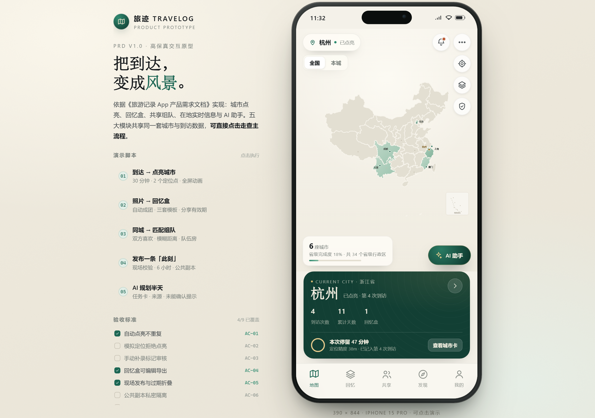
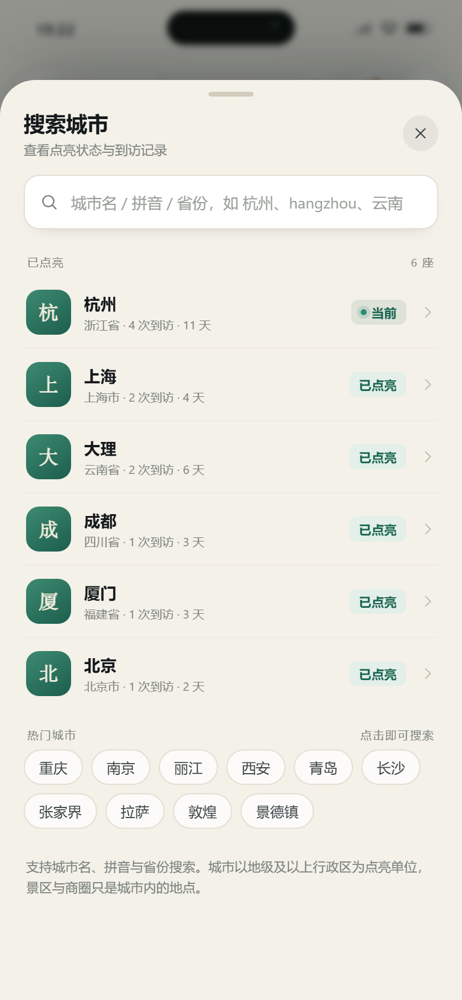

# 旅迹 Travelog · 旅游记录 App 高保真原型

依据《旅游记录 App 产品需求文档 V1.0》实现的**可运行、可点击演示**的 Web / PWA 原型。
覆盖 PRD 的五大模块：城市点亮、回忆盒、共享组队、在地实时信息（公共区域）与 AI 旅行助手。



---

## 快速开始

**方式一：直接打开（最简单，离线可用）**

双击 `index.html`，或用浏览器打开即可。所有资源都在本地，不依赖网络。

**方式二：本地服务（可安装为 PWA）**

Windows 双击 `启动原型.cmd`（或在目录内执行 `python -m http.server 8080`），
浏览器访问 <http://localhost:8080>，地址栏可出现「安装」入口。

> 建议用 Edge / Chrome / Safari 打开。移动端访问时自动全屏，桌面端显示手机外框与左侧演示导览。

---

## 演示脚本（6 条主流程）

左侧「演示脚本」可直接点击执行；也可以手动走：

| # | 流程 | 操作路径 | 关键看点 |
|---|------|----------|----------|
| 01 | 到达 → 点亮城市 | 地图页 → 底部「正在记录这次到达」→ 点亮 | 30 分钟 + 2 个定位点的判定、全屏点亮动画、城市卡 |
| 02 | 照片 → 回忆盒 | 回忆 → 右上「+」→ 开始生成 | 自动成团三步、18 张素材、三套模板、分享有效期 |
| 03 | 同城 → 匹配组队 | 共享 → 开启共享 → 发布名片 → 喜欢「林小满」 | 匹配理由、双方喜欢才匹配、队伍房与集合点 |
| 04 | 发布一条「此刻」 | 发现 → 发布 → 选「此刻」→ 提交审核 | 现场校验、6 小时有效期、公共副本去 EXIF、1.5 秒审核 |
| 05 | AI 规划半天 | 地图右下「AI 助手」 | 任务卡、来源与更新时间、明确的「未能确认」、每日额度 |
| 06 | 搜索一座城市 | 地图右上放大镜 / 发现页城市名 | 中文、拼音、省份三路匹配；已点亮 / 未点亮状态；直达城市卡或补录 |

搜索入口有两处：**地图页右上角放大镜**，以及**发现页顶部城市名**（弹出层里「搜索城市」）。输入 `da` 可看到拼音匹配，输入 `云南` 可按省份列出 5 座城市；未点亮的城市可直接进入「手动补录」。



想重走首次使用：**我的 → 重置演示数据**（或访问 `index.html?reset=1`）。

---

## PRD 覆盖对照

| PRD 章节 | 原型实现 |
|---|---|
| 3.1 城市与到访 | 地级市点亮、首次/最近到访、到访次数与累计天数、深度点亮样式、24 小时单条到访 |
| 3.2 回忆盒 | 自动成团、素材增删、按天时间线、三套模板、封面与音乐入口、7 天分享链接、30 天回收站 |
| 3.3 私密 / 公共区域 | 两套数据空间；发布时生成公共副本、位置模糊到商圈、EXIF 移除、删除互不影响 |
| 3.4 共享模式 | 四项开启条件、24 小时倒计时、名片预览、三档模糊距离、匹配理由、2–8 人队伍、安全中心 |
| 3.5 公共区域 | 此刻 / 今日 / 经验 / 文化 / 问答五类内容、现场标识、有效期与折叠、仍有效 / 已失效反馈 |
| 3.6 AI 助手 | 今日行程任务卡、实时问答、附近推荐、来源标注、不确定提示、收藏 / 加入行程 / 写进回忆盒、额度 |
| 5.x 功能需求 | 底部五个一级入口与全局 AI 入口，页面清单与 PRD 7.2 对齐 |
| 8 数据模型 | 城市、到访、旅行、回忆盒、素材、共享状态、队伍、内容、AI 会话均有对应状态结构 |
| 9 指标与风险 | 冷启动内容不足、定位异常、陌生人安全、AI 幻觉均在界面中有对应提示与兜底 |

### 验收标准（左侧面板实时打勾）

| 编号 | 触发方式 |
|---|---|
| AC-01 自动点亮 | 首次到达页点亮杭州（或左侧脚本 01） |
| AC-02 防作弊 | 地图右侧盾牌 → 模拟异常定位 |
| AC-03 手动补录 | 我的 → 城市横条「+」→ 选择城市提交 |
| AC-04 回忆盒 | 回忆 → 新建并生成（初始化即为已完成） |
| AC-05 现场发布 | 发现 → 发布 → 提交审核 |
| AC-06 公共副本隔离 | 回忆盒 → 更多 → 发布到公共区域 |
| AC-07 双方喜欢 | 共享大厅 → 喜欢「林小满」→ 匹配成功 |
| AC-08 AI 来源 | 向 AI 提问任意问题 |
| AC-09 注销冷静期 | 我的 → 注销账号 → 确认 |

---

## 设计说明

- **视觉语言**：暖纸色底 + 深松绿主色 + 黄铜金点缀，衬线字用于城市名与品牌，正文用系统无衬线。
- **动效**：页面 340ms 淡入上移；点亮页 4 层扩散光环 + 金色粒子；面板 420ms 上滑；均支持 `prefers-reduced-motion`。
- **信息密度**：以 390×844 为基准，8pt 间距体系；所有关键操作有 toast 反馈。
- **数据**：全部为本机 localStorage 演示数据，无后端、无网络请求；照片为本地占位素材。

## 文件结构

```
travel-app/
├─ index.html                 应用外壳（手机框 + 桌面导览）
├─ manifest.webmanifest       PWA 清单
├─ sw.js                      离线缓存
├─ assets/
│  ├─ css/app.css             设计系统与全部页面样式
│  ├─ js/
│  │  ├─ geo.js               中国省级地图数据（Albers 投影 + 简化）
│  │  ├─ data.js              演示数据
│  │  ├─ store.js             状态、持久化、业务动作
│  │  ├─ ui.js                图标、弹层、Toast、点亮动画
│  │  ├─ app.js               路由、导览、首次使用
│  │  └─ screens/             map / memory / share / discover / me / ai
│  ├─ img/                    18 张本地演示照片
│  └─ icons/                  PWA 图标
├─ screenshots/               各页面截图
├─ 启动原型.cmd
└─ 本地服务.cmd
```

## 已知边界

- 这是**交互原型**，不含真实定位、相册读取、地图 SDK、审核后台与模型调用；AI 回答为预置脚本。
- 共享大厅、公共内容、队伍消息为演示数据；刷新后保留在本机。
- 照片来自 Picsum 占位图，仅用于氛围演示，与城市无对应关系。
- 桌面端窄于 1000px 时自动切换为全屏移动布局。
