# 旅迹 Travelog · 前端与 Android

依据《旅游记录 App 产品需求文档 V1.0》与技术文档实现的可运行客户端：
**React 19 + TypeScript + Vite** 的移动端 PWA，加 **Capacitor 7 + Kotlin 原生插件** 的 Android 壳。

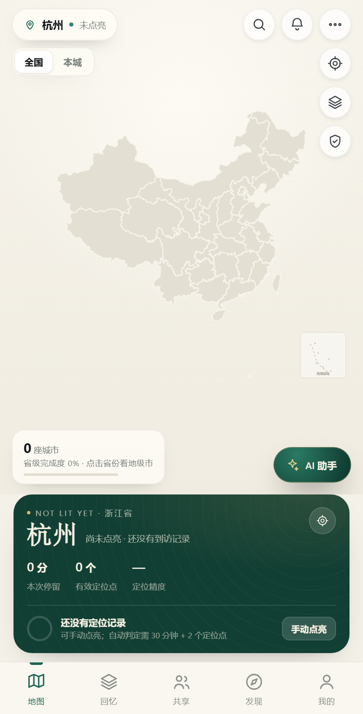

> **全局规则：默认无预置假数据。** 新注册用户的历史、收藏、行程、打卡、回忆盒、发布、
> 消息、同城大厅和队伍全部为空；每个页面使用独立空状态，不用演示用户或占位记录填充。
> 城市索引与景区目录属于系统内容，不包含任何用户到访或评价记录。

## 已实现

| 模块 | 内容 |
|---|---|
| 首次使用 | 手机号注册/登录 → 填写资料 → 选择要点亮的城市（或暂不选择） → 确认点亮 → 选择是否上传相册 → 定位授权 → 进入；下次直接进入 |
| 地图 | 中国省级地图、**点击省份进入地级市地图**、已点亮省份、城市卡、本城示意地图、定位/图层/风控入口 |
| 城市搜索 | 中文 / 拼音前缀 / 省份三路匹配，已点亮与当前城市标记，未点亮可直接手动补录 |
| 回忆盒 | 列表、草稿/已完成/回收站筛选、按天时间线、素材、三套模板、分享链接与撤销、删除回收 |
| 共享 | 开启条件、名片预览、同城大厅、匹配理由、双向喜欢、匹配成功、队伍房与聊天、安全中心 |
| 发现 | **推荐 / 避坑** 景区口碑、此刻 / 今日 / 经验 / 文化 / 问答、现场标识、发布与公共副本预览 |
| 景区推荐 | **点击地级市进入推荐页**：系统推荐、建议时长/票价/避坑提示、评论空状态，直达发现页 |
| AI | 实时问答入口；当前明确标注未接入天气/客流/营业数据，不生成虚构路线、餐厅或人流判断 |
| 我的 | 资料、统计、城市条、隐私开关、数据管理、注销冷静期、重置本机数据 |

## 空状态约定

- 数据源：`src/data/seed.ts` 的 `SEED` 中用户记录全部为空（城市 `{}`、回忆盒 `[]`、
  发布 `[]`、大厅 `[]`、队伍空、消息 `[]`、回收站 `[]`）。
- 新账号：点亮城市数、到访次数、回忆盒、照片、发布、未读消息、可匹配用户均为 0。
- 每个页面独立空状态：地图未点亮城市、回忆无盒子、发现无内容、共享大厅无人、
  我的无城市/黑名单 0；不使用演示用户或占位记录。
- 城市索引、景区目录、地图轮廓是系统内容，不含用户历史；景区评论默认 0 条。
- AI 未接实时数据时明确说明，不生成虚构路线、餐厅或人流判断。
- 重置入口：我的 → 重置本机数据；后端默认 `travelog.seed-demo=false`。

## 技术栈

- **前端**：React 19、TypeScript 5.8、Vite 6、React Router 7、Zustand 5（持久化到 localStorage）
- **样式**：原生 CSS 设计令牌 + 组件类，390–430px 移动优先，桌面居中预览
- **地图**：本地省级 + 地级市两级 GeoJSON，中国地图用 Albers 投影（`src/data/geo.ts`），省级地图按需加载，无外部地图依赖
- **Android**：Capacitor 7、Kotlin 2.0、AGP 8.7，自定义 `TravelogLocation` / `TravelogMedia` / `TravelogPush` 插件

## 快速开始（Web）

要求 Node 20+、pnpm 9+。

```bash
cd travelog-app
pnpm install
pnpm dev            # http://127.0.0.1:5173
```

> 若安装时提示 `Ignored build scripts: esbuild`，执行 `pnpm approve-builds` 选择 esbuild，
> 或改用 `npm install`。CI 中可用 `pnpm config set dangerouslyAllowAllBuilds true`。

生产构建与预览：

```bash
pnpm build
pnpm preview
```

### 评审参数

| 参数 | 作用 |
|---|---|
| 无参数 | 首次打开进入注册/登录；已注册用户直接进入地图（新账号默认空数据） |
| `?auth=profile` | 跳过手机号验证，直接查看资料填写页（评审用） |
| `?auth=city` | 直接查看城市选择页 |
| `?auth=album` | 直接查看相册选择页 |
| `?auth=permission` | 直接查看权限页 |
| `?auth=empty` | 空白账号直接进入 App，用于检查各页空状态 |
| `?province=330000` | 直接进入浙江省地级市地图（省级 adcode） |
| `?province=330000&city=330100` | 进入浙江省并打开杭州市**景区推荐页** |
| `?qa=1` | 冻结动画（用于截图/评审） |

数据全部在浏览器本地，重置入口：我的 → 重置本机数据。

### 注册、资料与持久登录

- 首次打开：手机号 + 验证码（演示码 `123456`）→ 同意协议 → 填写昵称、年龄、常住城市、
  简介、旅行偏好和头像颜色。
- **城市选择**：从系统城市列表里选一座想先点亮的城市，或选择「暂不选择」；选好后进入
  确认页，再决定「点亮」还是「暂不点亮」。
- **相册选择**：只有选择点亮后才出现；可以上传 1–9 张相册照片（本机预览，演示环境不上传原图），
  也可以暂不上传，进入后在回忆盒添加。
- 之后是定位授权与完成页；如果选择点亮，会再出现该城市的首城卡片并写入城市记录。
- 登录态、资料完成标记、城市/点亮/相册选择与引导完成标记都持久化在
  `localStorage` 的 `travelog.app.v2`；刷新或下次打开会**直接进入当前界面**，不需要再次登录。
- 如果在资料页、城市页、相册页或权限页中途关闭，下次打开会从对应步骤继续。
- 「我的 → 退出登录」会清除登录态但保留本机城市、回忆盒与发布内容；退出后回到注册页。
- 手机号为本地演示，不会发送真实短信；微信 / Apple 按钮为演示登录入口。

### 省级下钻（地级市）

- 在中国地图上**点击任意省份**，进入该省地图；只渲染地级市边界与名称，不展示区县。
- 顶部面包屑 `全国 / 浙江省` 可返回；底部显示该省已点亮城市数与到访次数。
- 已点亮城市（如杭州）按 adcode、全名、简称三级匹配后填充绿色；点击地级市进入**景区推荐页**。
- 数据在 `public/geo/provinces/{adcode}.json`，共 33 个省级单位、约 640KB，按需 `fetch` 并缓存；
  初始 bundle 不包含省数据。
- 直辖市与台湾等没有地级市下辖数据，回退为单个城市轮廓（北京、上海、天津、重庆、台湾）。
- 重新生成（需要联网，来源阿里云 DataV `areas_v3`，会做投影、简化与地级市过滤）：

```bash
python scripts/generate-province-geo.py
```

### 景区推荐与发现联动

- 地图 → 省 → 地级市 → `/recommend/:adcode`：系统推荐该市景区，包含建议时长、票价、
  开放时间、距离、适合标签与避坑提示。
- 推荐页每张卡都有「推荐 N / 避坑 N / 看评论」，可带 `spot` 参数跳到发现页对应口碑。
- 发现页新增 **推荐 / 避坑** 两个 Tab，按城市与景区过滤；评论卡可回到景区推荐页。
- 数据在 `src/data/scenic.ts`：20 个城市精选景区，其余城市用通用模板兜底。**评论默认空**，
  新用户不会看到任何预置推荐/避坑评论；只有真实发布后才会出现。
- 直达：`/discover?tab=recommend&city=杭州&adcode=330100&spot=西湖`。

## 测试

```bash
pnpm test
```

城市搜索单测覆盖：拼音前缀（`da` 只出大理/大连，不误命中青岛）、省份（云南 5 城）、
精确名称优先、无结果、城市索引数量。省级匹配单测覆盖：全名/简称、自治州前缀、adcode、未点亮。
景区单测覆盖：精选城市、通用城市兜底、**默认无预置评论**、城市 adcode 映射。
注册单测覆盖：账号创建、资料完成、localStorage 持久化、退出登录。

当前结果：**17 passed**。TypeScript `tsc --noEmit` 无错误，`vite build` 通过。

注册流程已做端到端实测：手机号 `13800001234` + 验证码 `123456` → 填写昵称/年龄/城市/偏好 →
选城市（可跳过）→ 选择点亮/不点亮 → 相册选择（可跳过）→ 定位授权 → 首城卡片 → 关闭浏览器后
重新打开，直接进入地图，无需再次登录。新账号进入后城市、回忆盒、发布、消息、大厅和队伍均为 0。

## Android

### 环境

- JDK **21**（Android Studio 自带 JBR 21；`JAVA_HOME` 需指向 21）
- Android Studio（SDK 35、Build Tools 35）
- 首次构建需联网下载 Gradle 与 Kotlin 插件

### 构建

```bash
pnpm build
npx cap sync android
npx cap open android        # 在 Android Studio 中运行
# 或命令行
cd android
./gradlew assembleDebug     # Windows: gradlew.bat assembleDebug
```

APK 输出：`android/app/build/outputs/apk/debug/app-debug.apk`。

> 当前开发机未安装 Android SDK，**APK 未在本机编译验证**；Web 端已完整构建与截图验证，
> Android 工程、Gradle 配置、Manifest 与 Kotlin 插件均按 Capacitor 7 规范生成。

### 原生能力

| 插件 | 能力 | 说明 |
|---|---|---|
| `TravelogLocation` | 定位权限、GPS/网络定位、`location` 事件 | 10s/25m 上报；生产建议换 FusedLocationProvider + Geofencing |
| `TravelogMedia` | 相册选择、拍照 | 返回 content URI，由 Web 层走预签名上传 |
| `TravelogPush` | 通知权限、token 契约 | 需接入 FCM / 国内厂商通道后生效 |

权限（`AndroidManifest.xml`）：精确定位、后台定位、相机、通知、读取图片。
Android 13+ 通知权限运行时申请；后台定位需在应用商店说明用途。

深度链接：`travelog://`；WebView 使用 `https` scheme，明文 HTTP 仅放行 `10.0.2.2` / `localhost`（开发）。

## 目录

```
travelog-app/
├─ src/
│  ├─ api/               # 数据适配层（当前为本地 mock，可替换为 HTTP）
│  ├─ components/        # Icon / Sheet / Toast / TabBar / ProvinceMap / SpotReviewCard / UI 原子
│  ├─ data/              # 空初始状态、城市索引、地图 GeoJSON、省级数据、景区目录
│  ├─ lib/               # 时间、城市搜索、省级城市匹配（含单测）
│  ├─ native/            # Capacitor 插件 TS 封装
│  ├─ screens/           # Map / Recommend / Memory / Share / Team / Discover / Me / AI / CitySearch / Onboarding
│  ├─ store/             # Zustand 全局状态与持久化
│  └─ styles/            # 设计系统与页面补充样式
├─ android/              # Capacitor Android 工程 + Kotlin 插件
├─ public/               # 照片、图标、manifest、geo/provinces 省级地级市数据
├─ scripts/              # 省级地图数据生成脚本
├─ screenshots/
└─ capacitor.config.json
```

## 与后端对接

`src/api/index.ts` 是唯一的数据入口，当前用延时模拟服务端并写入 Zustand：

- `auth.login()`、`cities.search()`、`visits.lightUp()`、`memory.create()`、`posts.publish()`、
  `share.start()`、`share.like()`、`ai.ask()`。
- 替换为真实接口时，保留方法签名，把内部实现改为 `fetch` 到
  `VITE_API_BASE_URL`（默认 `/api/v1`），并复用接口文档的统一信封
  `{ code, message, data, traceId }` 与 `Idempotency-Key`。
- 契约文件：`../travel-docs/openapi.yaml`（OpenAPI 3.1），可直接生成 TS 类型替换 `src/types.ts`。

定位点接入：`src/native/index.ts` 的 `TravelogLocation.addListener('location', ...)` 收到点后
按 50 条一批调用 `POST /location/points`；Web 端在 `initNative()` 中自动跳过。

## 已知边界

- 默认账号为空白状态；城市索引、景区目录、地图 GeoJSON 属于系统内容，不含用户历史。
- 无真实登录、支付、上传与推送；照片选择只在本机预览，不会上传原图。
- 地图为省级 + 地级市轮廓，未接高德/天地图底图；本城地图为示意图。
- 地级市数据来自阿里云 DataV 并简化，不含区县；直辖市与台湾为单城市轮廓。
- 省级地图按需加载 JSON，首次打开某省需要网络；已打开过的省在同一会话内缓存。
- Android 未本机编译；首次在 Android Studio 打开需允许 Gradle 下载依赖。
- 后台定位、FCM token、内容审核回调需在真实环境中接入。
- 当前图片为 Picsum 占位图，仅用于氛围，不代表任何真实用户内容。


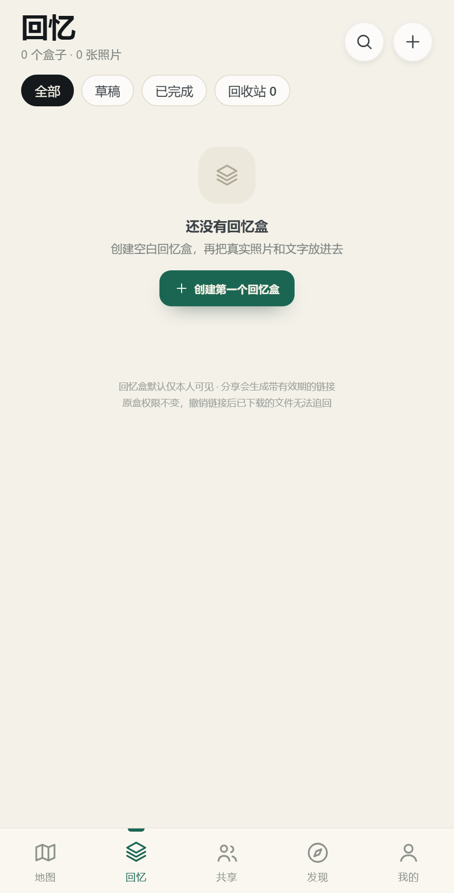
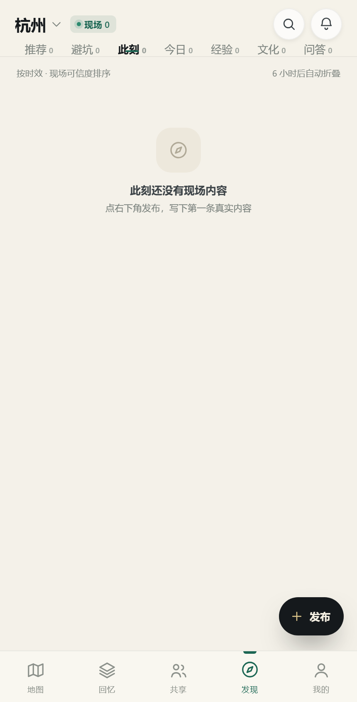
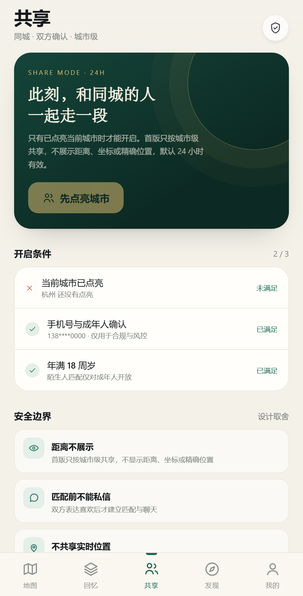
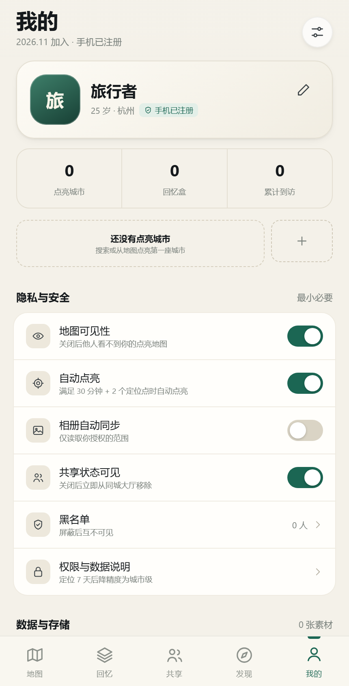
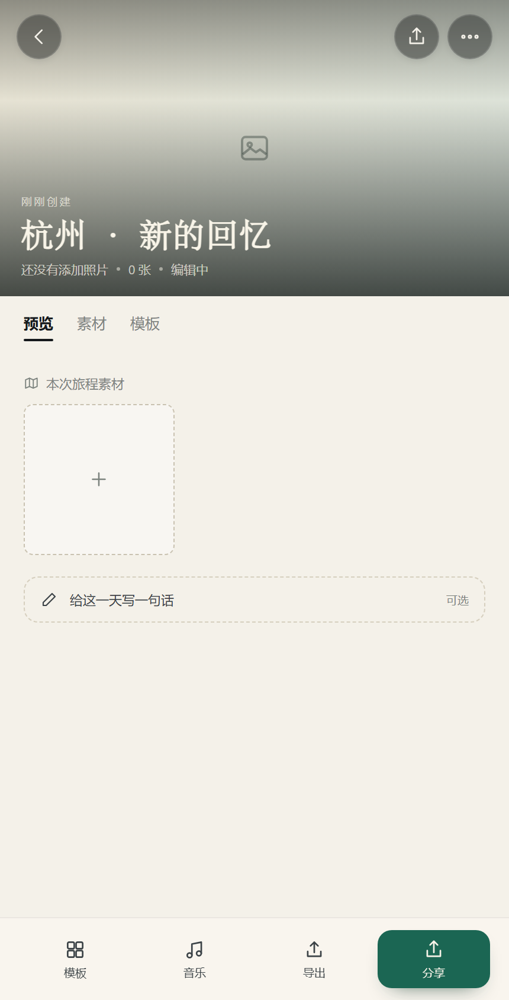
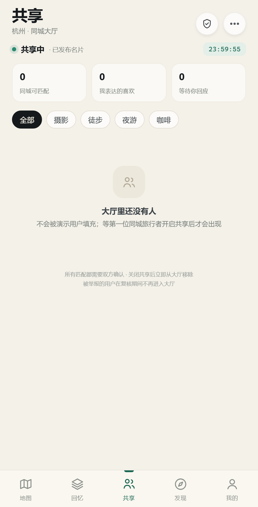
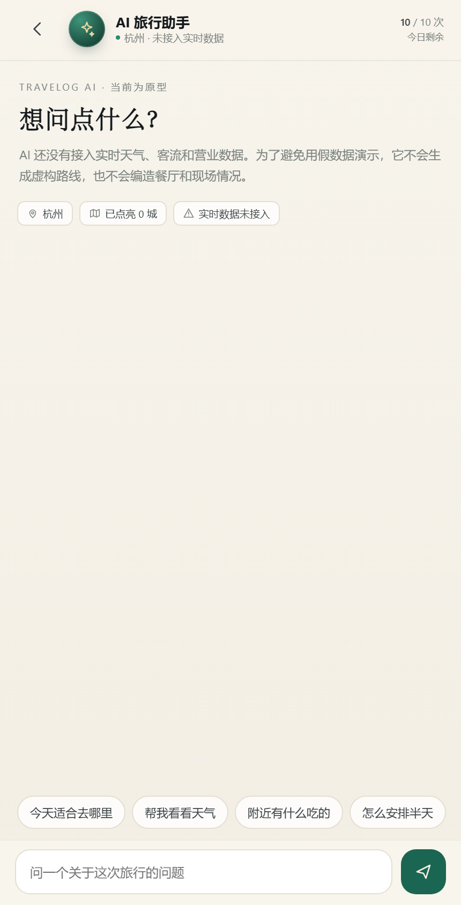
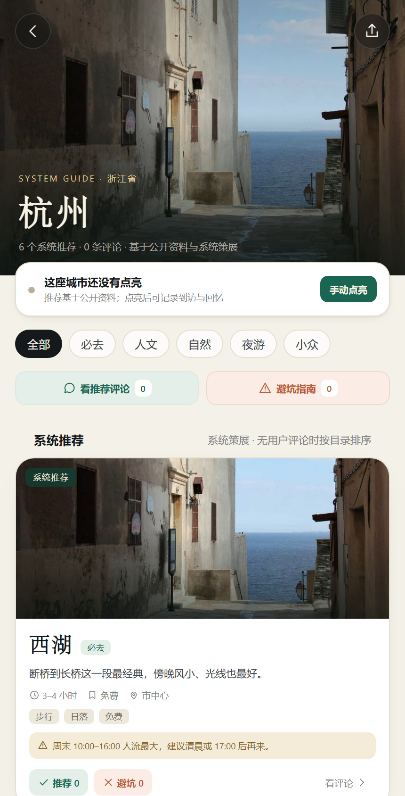
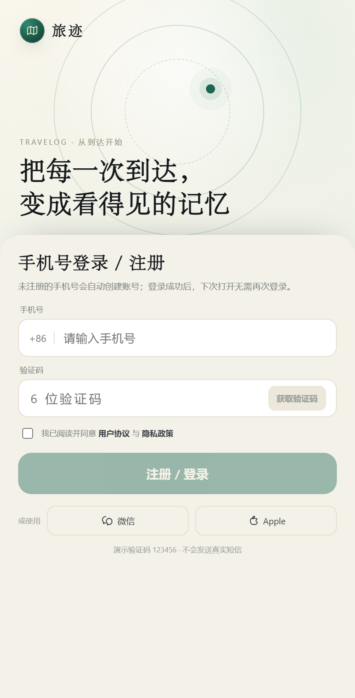

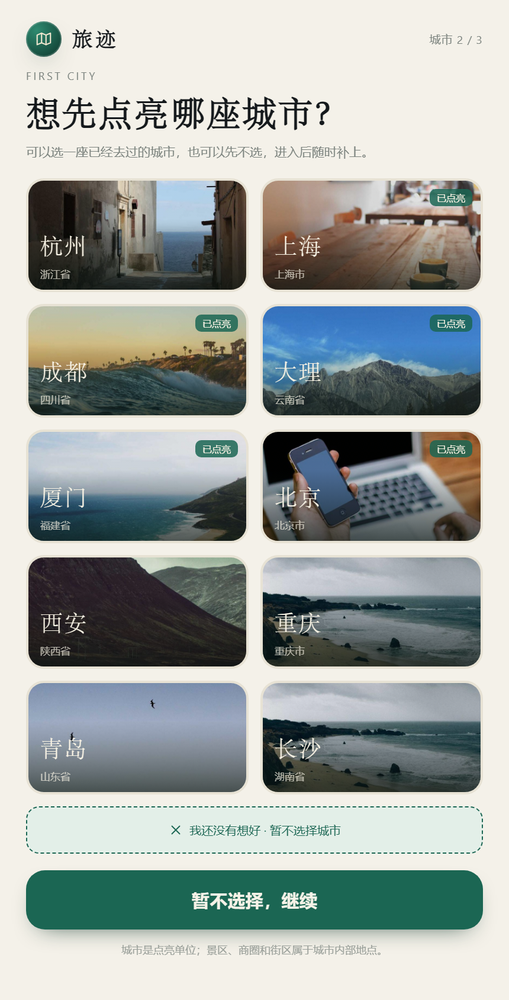

